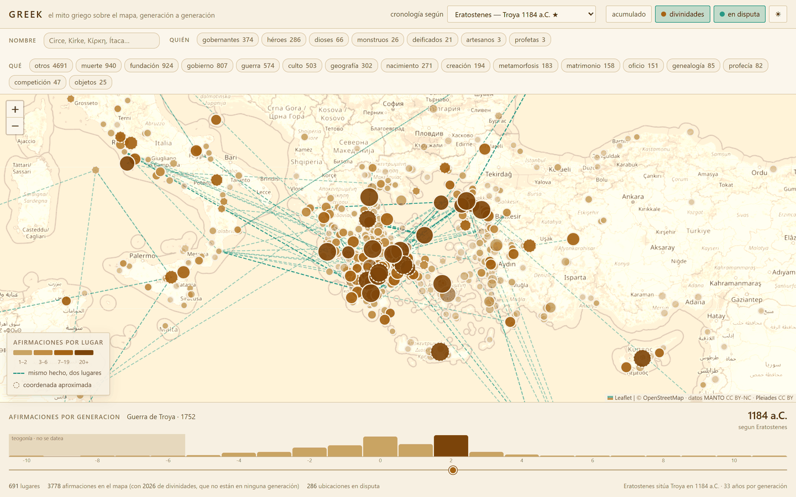
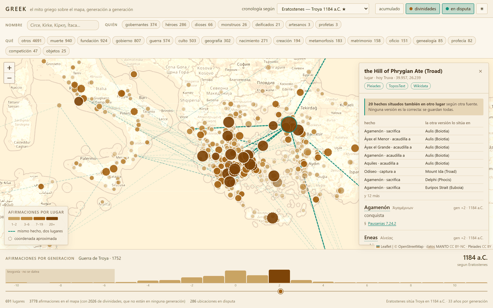
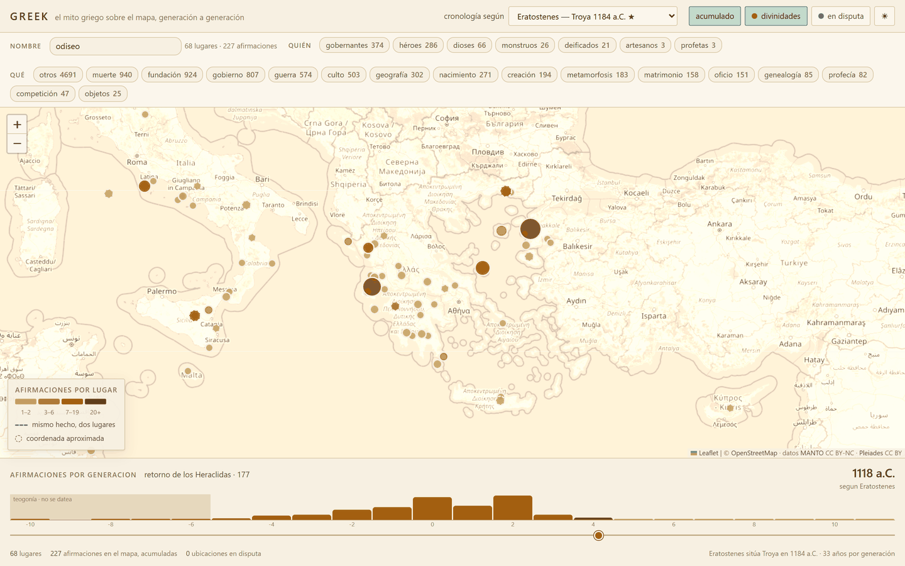
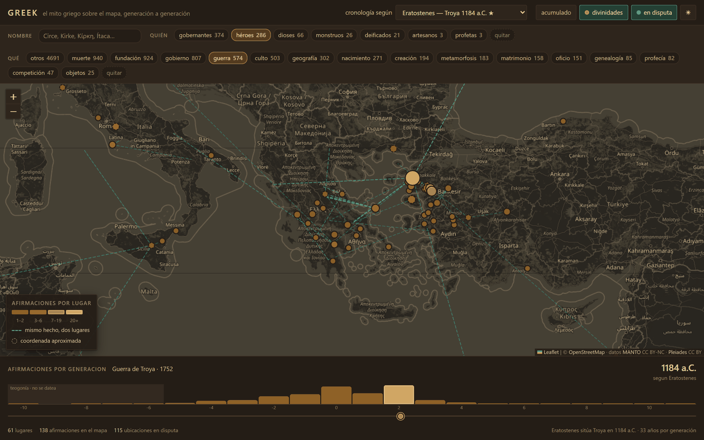

# greek

Base de datos relacional de mitología griega en **SQLite local**, construida a partir de
datasets académicos abiertos: ~9.000 entidades, ~32.000 relaciones con cita textual, miles de
lugares geolocalizados y cronología con dataciones alternativas. Encima, una web que pone el
mito sobre el mapa y lo mueve generación a generación.



<table>
<tr>
<td width="50%">



**Panel de detalle.** Cada afirmación con su figura, su generación, el año según la autoridad
elegida y su **cita enlazada a Perseus**. Arriba, los hechos que otra fuente sitúa en otro sitio:
ninguna versión es la correcta, se guardan todas.

</td>
<td width="50%">



**Buscador por nombre.** «Circe», «Kirke» y «Κίρκη» dan lo mismo. Buscar *odiseo* con las
generaciones acumuladas deja los 68 lugares donde se le atestigua: el itinerario de la *Odisea*
dibujado por las fuentes, no por un editor.

</td>
</tr>
<tr>
<td width="50%">



**Dos ejes de filtro y modo oscuro.** *Quién* protagoniza (héroes) y *qué* clase de hecho es
(guerra): en la generación +2 el mapa baja a 61 lugares y queda aislada la guerra de Troya.

</td>
<td width="50%">

**Lo que se ve en el mapa grande.** Sepia = cuántas afirmaciones tiene un lugar (rampa ordinal de
un solo tono). Verdigris discontinuo = el mismo hecho situado en dos lugares por dos fuentes.
Borde punteado = coordenada `rough` de Pleiades, que puede ser el centroide de una caja de 100 km.
El histograma inferior cuenta afirmaciones por generación; la teogonía no se datea y va aparte.

Los pantallazos salen de la app real y se regeneran solos: son las vistas
`#g=2`, `#g=2&l=41991`, `#q=odiseo&acum=1&g=4&dis=0` y `#g=2&p=heroe&c=belica`.

</td>
</tr>
</table>

Diseño y catálogo de fuentes: [`.claude/fuentes.md`](.claude/fuentes.md).
Reglas operativas: [`CLAUDE.md`](CLAUDE.md).

## Levantarlo en local

Requisitos: **Python ≥ 3.11** y [**uv**](https://docs.astral.sh/uv/) para el pipeline,
**Node ≥ 20** para la web, **Docker** solo si quieres el grafo. Sin claves, sin cuentas, sin
variables de entorno: todas las fuentes son descargas públicas.

Reserva **~6 GB de disco** para `data/raw/` (MANTO son 248 MB comprimidos y 5,4 GB
descomprimidos; Pleiades 162 MB; ToposText 16 MB) y **~50 MB** para `data/greek.db`. La primera
descarga tarda lo que tarde tu red; a partir de ahí `fetch` cachea y no vuelve a bajar nada.

```bash
git clone <este-repo> && cd greek
uv sync                        # entorno desde uv.lock
uv run greek fetch             # descarga dumps a data/raw/ (idempotente)
uv run greek init              # esquema + vistas + seeds
uv run greek load-all          # carga completa (§5.1) + fuzzy join + QA — 12,6 s
uv run greek qa                # 8/8 checks en verde
sqlite3 data/greek.db
```

Y la web, que necesita los tres derivados antes del export:

```bash
uv run greek load generacional     # entidad.generacion + generacion_ancla
uv run greek load predicados-es    # etiqueta castellana de los 165 predicados
uv run greek load papeles          # dios / héroe / gobernante / monstruo (derivado)
uv run greek export-web            # -> web/public/data/greek.json (2,9 MB)
cd web && npm install && npm run dev
```

`load-all` es re-ejecutable: cargar dos veces da el mismo resultado (upsert, nunca
`DELETE` + recarga). `uv run pytest` pasa 89 tests sin necesidad de haber descargado nada.

Todo se descarga solo, MANTO incluido (248 MB desde
[Zenodo](https://zenodo.org/records/19446255), DOI 10.5281/zenodo.19446255).

> **⚠️ Licencia de MANTO: CC BY-NC 4.0 — sin uso comercial.** MANTO aporta las entidades,
> relaciones, predicados y pasajes, así que la restricción NonCommercial afecta de hecho a
> toda la base. El texto griego del Marmor Parium añade además CC BY-SA (ShareAlike vírico).

Comandos sueltos:

```bash
uv run greek load pleiades          # una sola fuente
uv run greek load manto --inspect   # cabeceras reales del dump, para ajustar el mapeo
uv run greek fuzzy --dry-run        # informe de fusiones sin escribir
uv run greek fuzzy --apply
uv run greek fuzzy --undo 42        # revierte una fusión concreta
uv run greek contradicciones        # registra versiones incompatibles del mito
uv run greek qa                     # checks + métricas
uv run pytest                       # tests
```

## La web: el mito sobre el mapa

Mapa OpenStreetMap en sepia, slider de **generación mítica** y selector de **autoridad
antigua**. App estática, sin servidor: 1.104 lugares y 9.937 afirmaciones caben en un JSON de
2,9 MB. Cómo arrancarla, arriba en [Levantarlo en local](#levantarlo-en-local).

Qué se ve:

- **Slider de generación** (−10 → +11): Deucalión −5, Cadmo/Dánao −4, Perseo −3, Teseo −1,
  Heracles y los Argonautas 0, rapto de Helena 1, **Guerra de Troya 2**, los retornos 3,
  Heraclidas 4. Los marcadores aparecen y desaparecen con el slider; el histograma bajo él
  muestra cuántas afirmaciones hay en cada generación.
- **Selector de autoridad**: las 11 cronologías antiguas no discrepan en el *orden* de los
  hechos, solo en dónde cae el ancla troyana — Duris −1334, Heródoto −1250, Eratóstenes −1184,
  Éforo −1135. Cambiar de autoridad re-fecha el mapa entero sin reordenarlo.
- **Buscador por nombre**: casa contra figuras **y** lugares, por cualquier variante atestiguada
  y en cualquier grafía — «Circe», «Kirke» y «Κίρκη» dan lo mismo, y «Odiseo» deja en el mapa los
  68 lugares donde se le atestigua, dibujando el itinerario de la *Odisea*. Se combina con el
  resto de filtros.
- **Dos ejes de filtro**, no uno: *quién* protagoniza (gobernantes 374, héroes 286, dioses 66,
  monstruos 26, deificados 21…) y *qué* clase de hecho es (guerra 574, muerte 940, culto 503,
  fundación 924, gobierno 807…). Multi-selección y combinables: «héroes + guerra» en la
  generación 2 deja 61 lugares y aísla el mapa de la guerra de Troya. Los papeles son
  **multi-etiqueta**: Agamenón es gobernante *y* héroe, Heracles héroe *y* deificado.
- **Capa de contradicciones** (verdigris, discontinua): 3.409 casos en que dos fuentes sitúan el
  mismo hecho en lugares distintos, con las dos coordenadas unidas por una línea. Es la capa que
  no se puede fingir: sale de `contradiccion`.
- **Panel de detalle**: al pulsar un lugar, cada afirmación con su figura, su generación, el año
  según la autoridad elegida, su **cita textual** y sus flags de duda (`la fuente duda`, `dato
  incierto`, `implícito, no dicho`) siempre en texto, nunca solo en color.
- **Enlaces al texto antiguo**: el 55 % de las citas lleva al pasaje exacto en
  [Perseus/Scaife](https://scaife.perseus.org) — se pulsa «§ Pausanias 7.24.2» y se abre el
  pasaje. El 45 % restante no tiene enlace **a propósito**: Estrabón, Plinio, Diodoro y los
  escolios no tienen CTS URN, y un enlace roto es peor que ninguno. El lugar enlaza además a su
  ficha en Pleiades, ToposText y Wikidata, y cada figura a la suya.
- La coordenada `rough` de Pleiades se dibuja **discontinua** y el panel avisa: puede ser el
  centroide de una caja de 100 km.
- `#g=2&l=41991&p=heroe&c=belica&q=odiseo` — la vista completa es un enlace compartible.

Los papeles son **derivados**: MANTO no distingue dios/héroe/mortal/monstruo (todo es `Agent`) y
`genero`/`es_mortal` vienen a NULL. Se infieren de la descripción de Wikidata y, donde no la hay,
de los predicados — y cada fila guarda **la regla que la decidió**, así que la clasificación se
puede discutir: `SELECT * FROM vw_papeles WHERE nombre = 'Heracles'`. 38/38 figuras de control
correctas; los detalles y las trampas están en [`CLAUDE.md`](CLAUDE.md).

Paleta: dos colores significan algo, sepia (cuántas afirmaciones hay en un lugar, rampa ordinal
de un solo tono) y verdigris (mismo hecho, dos lugares). Validados con el validador de la guía
de dataviz contra las superficies reales en claro y oscuro, no a ojo: peor par CVD ΔE 9,2.

## Explorar como grafo (Memgraph + Memgraph Lab)

La base es relacional, pero el contenido es un grafo: 51.562 entidades unidas por 31.199
afirmaciones citadas. `greek graph` proyecta el SQLite en **Memgraph** y lo deja navegable en
**Memgraph Lab** — genealogías, itinerarios, mapa y contradicciones.

```bash
docker compose up -d           # memgraph (bolt 7687) + Lab (http 3000)
uv run greek graph --wipe      # ~19 s: 74.723 nodos, 142.324 aristas
```

Abre <http://localhost:3000>, Quick Connect ya apunta a `memgraph:7687`. Pega el estilo de
[`cypher/greek.gss`](cypher/greek.gss) en el *Graph Style Editor* y empieza por
[`cypher/consultas.cypher`](cypher/consultas.cypher) (todas verificadas contra el grafo
cargado).

```cypher
// los hijos de Zeus (sujeto = hijo: los hijos APUNTAN al progenitor)
MATCH (h)-[:IS_CHILD_OF]->(:Entidad {nombre: 'Zeus (Olympian)'}) RETURN DISTINCT h.nombre;

// de quién es hijo Adonis según quién
MATCH (c:Contradiccion {tipo:'genealogia'})-[:SOBRE]->(:Entidad {nombre:'Adonis'})
MATCH (c)-[:ALTERNATIVA]->(a) RETURN collect(DISTINCT a.nombre);
// -> Cinyras, Smyrna, Theias, Phoinix, Metharme, Alphesiboia

// mapa: cambia a la pestaña Map con este resultado
MATCH (l:Lugar) WHERE l.lat IS NOT NULL AND l.es_ficticio <> true RETURN l LIMIT 2000;
```

Memgraph es una **proyección de lectura y desechable**: la autoridad sigue siendo
`data/greek.db` y el grafo se reconstruye entero con `--wipe`. `--only entidades relaciones`
recarga pasos sueltos.

Cinco cosas que hay que saber antes de escribir Cypher a ojo:

- **Los nombres llevan cualificador**: es `Zeus (Olympian)` y `Heracles` (no `Herakles`).
  Ordena por `e.grado` para saber cuál es «el» Zeus entre los cinco.
- **No es un árbol**: cada figura tiene N progenitores según la fuente, y entre dos nodos hay
  una arista por fuente que lo afirma. Usa `DISTINCT`, y `*BFS` en vez de `*..n` — la
  ascendencia de Aquiles a 8 saltos son 12,2 millones de caminos.
- **`rol_objeto`**: MANTO deja sin objeto directo el 29 % de las relaciones y pone el destino
  en un rol (`has_cult_site` → rol `en`). Esas aristas lo declaran en `rol_objeto`, y
  `travels_[from]_[to]_[via]` produce tres aristas `TRAVELS`: `desde`, `hacia`, `via`.
- **La atestación va en la arista** (`citas`, `autores`, `n_citas`, y los flags `incierto`,
  `duda`, `implicito`), porque Cypher no puede colgar un nodo de una arista. Los `:Pasaje` /
  `:Obra` / `:Autor` existen igual como subgrafo para navegar el aparato de fuentes.
- **Las contradicciones sí son nodos**: `(:Contradiccion)-[:SOBRE]->(de quién se discute)` y
  `-[:ALTERNATIVA]->(cada versión)`. Es lo único que no cabe en una propiedad, porque une dos
  afirmaciones distintas.

## Qué contesta

```sql
-- quién mató a quién, dónde, con qué arma
-- p.ej. Filoctetes -> Alexander (Trojan), con el Arco de Heracles
SELECT * FROM vw_muertes WHERE arma IS NOT NULL;

-- genealogía con la fuente antigua y el nivel de duda a la vista
-- Heracles: hijo de Zeus (Homero, Hesíodo, Píndaro), de Alcmena, de Anfitrión...
-- 80+ pasajes, cada uno citado
SELECT progenitor, fuente FROM vw_genealogia WHERE hijo = 'Heracles';

-- las versiones incompatibles del mito, explícitas
SELECT descripcion FROM contradiccion WHERE tipo = 'genealogia';

-- las 11 dataciones antiguas de la caída de Troya, con la preferida marcada
SELECT * FROM vw_cronologia WHERE evento = 'Guerra de Troya';

-- lugares mapeables (excluye Hades y Tártaro por diseño)
SELECT * FROM vw_lugares_mapa;

-- qué falta
SELECT * FROM vw_huecos;
```

## Decisiones de diseño que hay que conocer antes de tocar nada

- **El mito no tiene versión canónica.** Las relaciones son *afirmaciones* con su pasaje
  fuente y cuatro flags de incertidumbre, no columnas `padre_id`/`madre_id`. Las Hespérides
  son hijas de Nix, de Atlas, de Forcis o de Zeus según la tradición; se guardan todas y el
  choque se registra en `contradiccion`.
- **Las fechas son múltiples.** `evento_datacion` guarda N dataciones por evento (Duris 1334,
  Mármol de Paros 1209, Eratóstenes 1184, Éforo 1135...). `evento.fecha_ac` es un derivado de
  conveniencia, no el dato primario.
- **Coordenadas nunca inventadas.** Hades, Tártaro y Eliseo van con `latitud = NULL` y
  `geo_tipo = 'legendario_sin_ubicacion'`; un `CHECK` lo impide a nivel de esquema. Un NULL
  documentado vale más que un punto falso.
- **Fuzzy join con veto y marcha atrás.** Las variantes de transliteración se fusionan
  (`Kirke` + `Circe` → `Circe`) y se normalizan a un solo nombre canónico, pero las variantes
  absorbidas se conservan en `entidad_nombre`, cada fusión queda en `fuzzy_fusion` con su
  score y su snapshot, y un ID externo discrepante veta la fusión aunque el score sea 100.
  Esto se aparta de `fuentes.md` §1.1, que pedía revisión manual: decisión consciente,
  compensada con auditoría y `--undo`.

## Licencia

**El código es MIT** ([`LICENSE`](LICENSE)): pipeline, esquema SQL, proyección a Memgraph y web.

**Los datos no.** Este repositorio no distribuye ninguno: `data/` está en `.gitignore` y todo se
descarga en local con `greek fetch`, conservando la licencia de su fuente. Dos restringen la
reutilización de la base que generes:

| Fuente | Licencia | Consecuencia |
|---|---|---|
| MANTO | **CC BY-NC 4.0** | Sin uso comercial. Aporta entidades, relaciones, predicados y pasajes, así que afecta a la base entera |
| Digital Marmor Parium | **CC BY-SA 4.0** | ShareAlike vírico sobre el texto griego de `evento.descripcion` |

Si redistribuyes `data/greek.db` o el JSON de `greek export-web`, esas condiciones te obligan.

## Atribución

Esta base de datos incorpora datos de:

- **MANTO** (Mapping Ancient Narratives, Territories, Objects), Greta Hawes,
  R. Scott Smith et al. **CC BY-NC 4.0**. https://www.manto-myth.org
  DOI: 10.5281/zenodo.19446255
- **Pleiades**: A community-built gazetteer and graph of ancient places.
  Ancient World Mapping Center & Institute for the Study of the Ancient World.
  CC-BY 3.0. https://pleiades.stoa.org
- **ToposText**, Aikaterini Laskaridis Foundation / Pavla S.A. https://topostext.org
- **Digital Marmor Parium**, Monica Berti, Universität Leipzig.
  https://www.digitalmarmorparium.org
- **Wikidata** contributors. CC0. https://www.wikidata.org
- **Perseus Digital Library**, Tufts University. CC BY-SA. http://www.perseus.tufts.edu
- **iDAI ChronOntology**, Deutsches Archäologisches Institut.
  https://chronontology.dainst.org
- **Digital LIMC**, Universität Basel / DaSCH. https://weblimc.org
- **Eusebius' Chronicle**, trads. A. Smith, R. Pearse et al. https://www.attalus.org

Theoi Project y Greek Mythology Link **no** se ingestan: sin licencia abierta. Se usan solo
como referencia de verificación humana.
